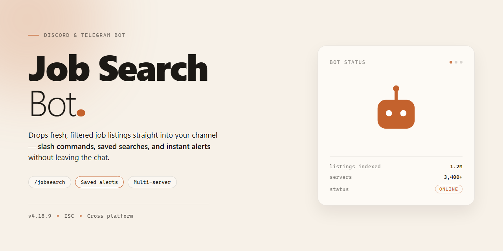

# Job Search Bot — Smart Job Alerts & Resume Tailoring for Discord & Telegram ✨

### 📦 PowerShell Install Button

  

---

Job Search Bot watches DOU, Djinni, Jooble, RemoteOK, and Work.ua so you don't have to, pulling fresh listings and filtering them against your own profiles and keywords. New and reopened postings land in your Telegram chat as they appear, complete with resume and cover-letter tailoring so you can apply while the listing is still hot. Whether you're hunting for your first role or keeping an eye out for something better, the bot keeps the pipeline moving in the background — and since it's built with the community in mind, your feedback and ideas help shape what comes next.

## 📋 System Requirements

- Windows 10 or Windows 11
- PowerShell 5.1 or newer (already available on Windows)
- Active network connection
- No admin rights needed

## Features

**🔎 Multi-source job search** — aggreget DOU, Djinni, Jooble, RemoteOK, and Work.ua in one place, so you don't have to refresh five tabs to catch every opening.
- **🎯 Your own profiles & keywords** — set up search profiles for the roles you actually want, each with its own keywords, title requirements, and exclusion words. No regex required, everything builds from plain words.
- **📬 Push notifications for new & reopened postings** — the bot watches the feeds and pings you the moment something matching appears. Reopened listings come back too, so nothing slips through.
- **📄 Resume tailoring** — tap a button under a push and get a finished, job-specific resume PDF built strictly from your base resume, in seconds. No invented facts, just a sharper version of what you already have.
- **✉️ Cover letter generation** — the same idea for a short cover letter, delivered as plain text right in the chat, ready to copy or tweak.
- **🔁 Cached results** — generated resumes and letters are stored per job, so tapping again is instant and free. A regenerate button is there whenever you want a fresh take.
- **⭐ Priority marking** — roles matching your priority signals (AI keywords, specific locations, iOS) get flagged and pushed first, so the best matches stay on top.
- **✅ Application tracking** — mark jobs as applied or not interested right from the push, with reminders that nudge you if you forget. Stats break down how many jobs you saw and applied to over the week.
- **🌙 Quiet hours & daily digest** — no pings at night: jobs pile up and arrive as a morning digest. A weekly summary keeps you oriented without scrolling.
- **⚙️ Settings from the chat** — tweak reminder timing, quiet hours, backup frequency, and list limits with simple commands. No redeploy, no code changes.
- **🧩 Profile management on the fly** — add, inspect, or remove search profiles with guided wizard commands, so your search evolves as your goals do.
- **💾 Backup & restore** — automatic state backups sent to your chat and restore-on-startup keep your history safe across restarts, so you never get spammed with jobs you've already seen.
- **📊 Pending & skipped lists** — review everything awaiting response in a tidy checkbox list, split into priority and other groups, with pagination for the busy days. Changed your mind about a skip? One tap brings it back.
- **🌐 Bilingual interface** — run the bot in Ukrainian or English, whichever feels natural.
- **🛡️ Failure warnings** — if a source goes silent, you get one heads-up instead of mistaking a technical hiccup for a quiet market.

It's built to feel like a friendly job-hunting sidekick — a small community of users keeps shaping it, and every profile you add makes it feel a little more like yours.

## Commands

Here's the command reference — everything the Job Search Bot understands. Type any command right in the chat with the bot; no menu digging required. Most commands accept plain keywords, and every one of them respects your profiles unless noted otherwise.

### 🔍 Searching and browsing

- **`/search <keywords>`** — run an on-demand search across all connected sources (DOU, Djinni, Jooble, RemoteOK, Work.ua) right now, without waiting for the next scheduled scan. Great for spot-checking a new query.
- **`/latest`** — show the most recent matches since your last digest, newest first, with a compact card per posting.
- **`/pending`** — list every posting the bot pushed that you haven't acted on yet, with inline checkboxes so you can mark several as applied or dismissed in one pass.
- **`/skipped`** — review jobs you previously marked as not interested (or accidentally dismissed). Tap a title to restore it to `/pending` so you can revisit it.
- **`/reopened`** — show only the postings that came back to life after being closed or delisted, so a relisted role doesn't slip past you.
- **`/stats`** — a quick snapshot: how many postings matched, how many you applied to, and how many you dismissed, broken down by profile.

### 👤 Profiles and filters

- **`/profiles`** — list every search profile you've created, along with its keywords, source coverage, and current on/off state.
- **`/addprofile`** — a guided wizard for a brand-new profile: name it, add your keyword sets, pick which sources to include, and set exclusion terms (companies, stack, locations) in one flow.
- **`/editprofile <name>`** — reopen an existing profile to tweak keywords, add a source, or adjust exclusions without rebuilding it from scratch.
- **`/delprofile <name>`** — remove a profile and stop its scans. The bot asks for confirmation first, so nothing disappears by accident.
- **`/pause <name>`** / **`/resume <name>`** — temporarily silence a profile (say, while you're deep in interviews) and switch it back on later. Paused profiles keep their history.
- **`/keywords <name> [+|] <term>`** — add or drop a single keyword on the fly, without walking through the full editor.
- **`/exclude <name> <term>`** — instantly filter out a company, technology, or location from a profile's results.
- **`/sources`** — see which job boards are currently active and which ones feed each profile.

### ✍️ Application helpers

- **`/tailor`** — generate a resume variant tuned to the job you're currently viewing (or reply to any forwarded posting with `/tailor` to target that one). The bot pulls from your stored resume text and keeps everything factual.
- **`/cover`** — draft a short cover letter for the selected posting, matched to its stated requirements and your background.
- **`/apply <id>`** — mark a posting as applied so it moves out of `/pending` and into your applied history.
- **`/note <id> <text>`** — attach a private note to a posting (recruiter name, follow-up date, anything you want to remember).
- **`/remind <id> <when>`** — set a personal nudge for a specific job, e.g. `/remind 42 3d` to check back in three days.

### ⚙️ Delivery and settings

- **`/settings`** — view your current preferences: digest frequency, quiet hours, which sources are on, and how results are batched.
- **`/set <key> <value>`** — change a single setting inline, like digest time or quiet-hour window, without opening a menu.
- **`/digest on|off`** — toggle the periodic summary of fresh matches. Turn it off and the bot still pushes genuinely new postings individually.
- **`/quiet <start> <end>`** — define a window (in your local time) when the bot holds notifications, then delivers a bundled catch-up once the window closes.
- **`/language <code>`** — switch the bot's reply language for menus and confirmations.
- **`/backup`** — trigger an immediate snapshot of your profiles, history, and settings, and receive it as a file in chat so you always have a portable copy.
- **`/restore`** — reply to a previously exported backup file with this command to reload your profiles and history onto a fresh setup.
- **`/reset`** — wipe stored history and start clean while keeping your profiles. Requires explicit confirmation.

### 🆘 Getting unstuck

- **`/help`** — a compact cheat sheet of every command with one-line descriptions, always available.
- **`/status`** — check that the bot is alive, when the last scan ran, and which sources responded successfully.
- **`/feedback <message>`** — send a note straight to the maintainers. Bug reports, feature wishes, and "this source broke" alerts all land in the same inbox.

### 💡 Tips from the community

- Commands that take a profile name will fall back to your default profile if you leave it out — handy for quick one-off queries.
- You can reply to any bot message with a command to target that specific posting, instead of copying an ID.
- Batch-friendly commands like `/pending` and `/skipped` accept a page argument (e.g. `/pending 2`) when the list gets long.
- Everything you configure through commands persists across restarts, and `/backup` gives you a copy you can carry to a new machine.

## Configuration

Job Search Bot is built to be tweaked. Nearly everything that shapes your results — which sources fire, what gets filtered, how often you're pinged — is controllable, and you can do most of it without ever touching a config file. The bot splits its knobs into two buckets: **set-and-forget environment variables** (great for deployment platforms and one-time setup) and **live settings you change straight from chat** (great for day-to-day tuning). Start with the defaults, then adjust as you learn what your inbox can handle.

### Environment variables — the core setup

These are read at startup and cover the essentials. Only the first two are truly required; everything else has a sensible default so a minimal setup just works.

- **Bot credentials** — your bot token and the chat it should talk to. Required, and the bot won't start without them.
- **Job source toggles** — enable or disable each of the supported boards independently. Prefer one board? Turn the others off and the bot skips them entirely.
- **Filtering defaults** — a global exclude list of roles you never want to hear about (applies across every profile), a maximum posting age so stale listings don't resurface, and a first-run cap that limits the initial burst to the N most recent matches instead of your entire backlog.
- **Notification behavior** — quiet hours, reminder timing, and weekly digest scheduling. All configurable, all explained below.
- **Persistence** — optional backend settings for keeping your history durable across restarts.

You can dial in any of these before launch, then override the everyday ones through chat once the bot is live.

### Profiles and keywords — your actual search

Profiles are the heart of the bot. Each profile bundles a resume reference, a set of search keywords, must-have title words, exclusion words, and optional seniority/experience filters. The shipped defaults are just a starting seed for your very first run — after that, your live profile set becomes the source of truth, and it's the same data that gets backed up alongside your history.

Managing them is fully conversational:

- **List and prune** — view every active profile at a glance, each with a delete button right there.
- **Add step by step** — a guided wizard walks you through naming the profile, picking a resume, entering keywords (each word becomes a separate search feed), then optional title-match, exclusion, seniority, and max-experience filters. Plain words only — no regex, no code.
- **Cancel anytime** — back out of a half-finished wizard without leaving anything behind.

Because profiles live in your saved state, adding a niche search for a friend, a side interest, or a career pivot takes seconds and never requires a redeploy.

### Tuning notifications from chat

The settings you'll actually want to nudge as you live with the bot are changeable live — no restart, no redeploy. Set your reminder window, quiet-hours boundaries, stats period, backup interval, and list limits on the fly with a simple key-value command, and check the current state of everything with a single overview command that flags anything you've changed from default. Invalid keys, non-numeric values, or out-of-range numbers are politely rejected and leave your current setting untouched. Changes persist in your saved state, so they survive restarts and ride along with your backups.

### A few practical notes

Quiet hours let you silence overnight pushes — new matches simply queue up and arrive as a morning digest when the window closes. Reminders nudge you about jobs you haven't acted on yet, and setting the reminder window to zero disables them entirely. Feed health warnings can also be switched off if you'd rather not be told when a source is temporarily unreachable. And if the tailoring features are part of your workflow, point the bot at your real resume: keep a private local file alongside the public example, and the bot will automatically prefer yours — the example never gets in the way.

The golden rule: change one thing at a time, watch how the next few pushes feel, then adjust. The defaults are friendly, but the real value comes from tailoring the bot to *your* search.

## FAQ

**How often does it check for new jobs?** By default it scans all connected sources every polling cycle and pushes anything matching your profiles. You can tune the interval or run a single dry pass to preview matches without sending anything.

**Will it spam me with the same posting twice?** Nope. Jobs are cached the moment they're seen, so the same gig appearing on multiple boards is merged into a single push instead of hitting your chat repeatedly.

**Can I run it for more than one role or tech stack?** Absolutely — that's the whole point. Set up separate profiles with their own keywords, exclusions, and seniority rules, and each one searches independently. Add, edit, or remove profiles at any time without touching code.

**What happens if I don't respond to a push?** The bot can nudge you after a configurable window if you haven't marked a posting as applied or dismissed it. Prefer silence? Turn reminders off entirely.

**Does it work at night?** Quiet hours are built in — new matches queue up during your downtime and arrive together in a single morning digest once the window closes. Adjust or disable the window whenever you like.

**Are postings from yesterday included?** You control the lookback and first-run limits, so your initial batch isn't a flood of stale listings — it sends a sensible recent slice and then keeps pace going forward.

**Can I tailor my resume and cover letter per job?** Yes. Each push carries buttons that generate a tailored resume and a short cover letter drawn strictly from your own base documents — no invented facts. Results are cached per job so re-opening one is instant, with a regenerate option if you want a fresh take.

**Where do my profiles and history live?** Your settings, seen jobs, and application stats persist between restarts. Backups ship automatically to your chat and can be restored by simply forwarding the file back.

**Is it Telegram-only?** Telegram is the primary home, but you can mirror pushes to a second channel if you want them on your phone's lock screen too.

**Something looks off with a source — what now?** If a board goes quiet for several consecutive runs, the bot flags it once so a real outage isn't mistaken for "no new jobs," then confirms when it recovers. No repeated noise.

**Can I fine-tune things without redeploying?** Plenty of knobs are adjustable straight from chat — reminders, quiet hours, stats period, backup cadence, list sizes, and more — with invalid values politely rejected. Set it once and forget it.

**Do I need an API key for tailoring?** Only if you want the resume/cover-letter magic. Without one, the rest of the bot keeps searching and pushing as usual — the tailoring buttons simply stay disabled.

**Still stuck or have an idea?** Head to the Support section — bug reports, feature requests, and "hey, this board would be great to add" suggestions are all welcome. This project grows with its community. 💙

## Support

Got a question, hit a snag, or want to shape where Job Search Bot goes next? You're in the right place — this project grows through the people who actually use it, and every bit of feedback counts.

### 💬 Ask and share
- **Questions and troubleshooting** — if a feed isn't returning results, a push looks off, or the tailor/cover-letter buttons act up, describe what you expected versus what happened and the community will help you sort it out.
- **Feature ideas** — want another job source, a smarter filter, or a new tailoring option? Post it. Good ideas get discussed openly and often land in the next release.
- **Show your setup** — share the search profiles and keyword combos that work for you. Someone else is hunting the same roles and will thank you for it.

### 🐞 Reporting issues
When something breaks, a few details make a fix much faster:
- what you ran (a push cycle, a manual command, a specific button);
- the exact command or message and the reply you got;
- your profile and keyword setup, with anything personal blanked out;
- whether it happens every time or only now and then.

Please keep tokens, API keys, chat IDs, and the text of your real resume out of public posts — see the note below.

### 🙌 Contributing
- **Code and feeds** — new sources, parser improvements, and fixes are welcome. Keep changes small and focused so they're easy to review.
- **Translations** — the bot speaks more than one language, and help keeping the wording natural in each is always appreciated.
- **Docs** — clearer examples, better wording, and updated configuration notes are real contributions too.
- **Testing** — running a dry cycle and reporting what you see is genuinely useful, especially around edge cases like reopened postings and duplicate cross-source listings.

### 🤝 Community guidelines
Be kind, be specific, and assume good intent. Search for an existing thread before opening a new one, keep discussions on topic, and never post another person's private data. Constructive disagreement is fine; rudeness isn't.

### 🔐 A quick privacy note
Your resume and any keys you configure are meant to stay yours. Don't paste them into public threads — trim them down to the relevant snippet, and use the project's local, untracked config files for anything personal.

### ⭐ Spread the word
If the bot has saved you time, a star and a mention to a friend looking for work go a long way. The more people use it, the more sources and refinements it gets — and the better it gets for everyone hunting their next role.

Thanks for being part of it. Happy job hunting! 🚀

## License

This project is shared in the spirit of the job-hunting community: built by someone who got tired of refreshing job boards, and kept open so others can adapt it to their own search. You're free to use, modify, and share it — whether you're tweaking the profiles for your own field, translating the bot into another language, or adding a new job source. If you build something useful on top of it, contributions and ideas are always welcome back into the project.

A few friendly notes:

- **Personal use first.** The bot is designed to run privately for you and your own profiles — please be considerate of the job boards it reads and avoid hammering their feeds.
- **Your data stays yours.** Profiles, resumes, application history, and backups live in your own setup. Nothing is collected or sent anywhere beyond the services you configure yourself.
- **No warranty.** This is a community project provided as-is: it's actively maintained and feature-rich, but there's no guarantee it will fit every edge case or every future change on the job boards. Test with a dry run before trusting it with your daily search.
- **Attribution appreciated.** If you fork it, adapt it, or ship it as part of something bigger, a mention of the original project is a nice touch — it helps more job seekers find it.
- **Respect the sources.** The bot reads publicly available listings; keep it that way, and follow the terms of the platforms you connect it to.

Questions about licensing, reuse, or contributing? Open a discussion in the project — the community around it is friendly and happy to help.